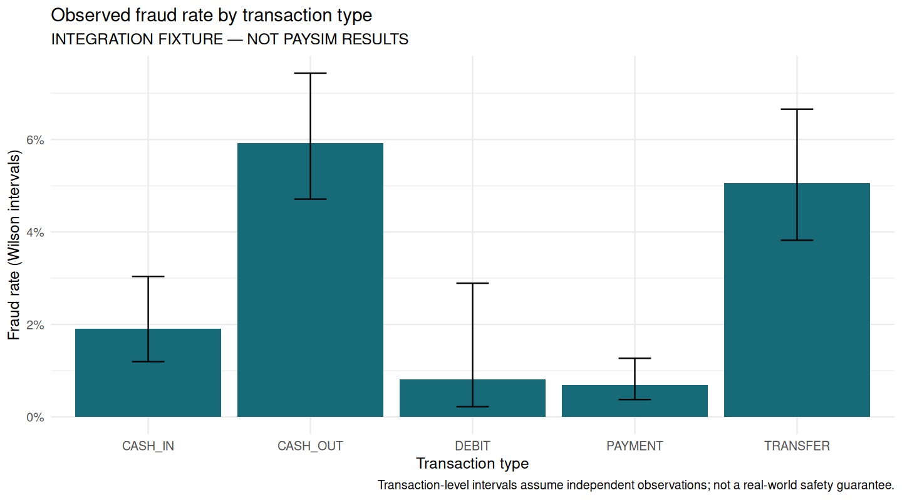

# Payment Fraud Risk Observatory

**Fraud & Risk Data Analyst portfolio — SQL, Python, rule evaluation, investigation and business decisions.**

This project turns mobile-money transactions into a reproducible fraud-risk review:
strictly historical features, time-separated model selection, an existing-control
benchmark, investigation evidence, review-workload costs and an interactive dashboard.

**Validation status:** the implementation and dashboard have been tested on a seeded
24,000-row **integration fixture, not PaySim results**. The source PaySim CSV is not
included and could not be downloaded in this environment. Earlier notebook performance
claims are withdrawn until the corrected pipeline is run on that source data.

## Start here

```bash
python -m venv .venv
# macOS/Linux: source .venv/bin/activate
# Windows PowerShell: .venv\Scripts\Activate.ps1
python -m pip install -e '.[dev]'
python -m pytest -q
python -m fraudrisk.pipeline --demo
python -m streamlit run dashboard/app.py
```

Alternatively, open `outputs/dashboard.html` in a browser after a run. It is a
self-contained interactive Plotly report that works without a server or CDN.
Use the Streamlit app for queue filtering and CSV downloads.

## R statistical analysis

An independent R layer uses **dplyr, ggplot2, jsonlite and base R statistics** to
reconstruct detection rules, reconcile Python metrics, calculate recipient-cluster
bootstrap confidence intervals, analyse transaction-type associations and generate
three charts. Model and threshold remain frozen; no test-label retuning occurs.

```bash
Rscript -e 'install.packages(c("dplyr", "ggplot2", "jsonlite"), repos="https://cloud.r-project.org")'
Rscript r/test_validation.R
Rscript r/validate_fraud.R outputs
```

See [R setup and limitations](r/README.md). Outputs appear under `outputs/r/` and
in the dashboard's Decision brief tab when available. CI executes the R checks
and retains its reports and plots with the Python evidence. `tidymodels` is not
used or claimed. Fixture analysis remains explicitly labelled as fixture results.

[Executed R validation report](reports/verification/r/validation_report.md) ·
[Python/R metric reconciliation](reports/verification/r/python_r_parity.csv)



For the actual dataset, follow [data acquisition](data/README.md), then run:

```bash
python -m fraudrisk.pipeline --input data/PS_log.csv --output outputs/paysim
# macOS/Linux; on PowerShell use $env:FRAUD_OUTPUT_DIR='outputs/paysim'
FRAUD_OUTPUT_DIR=outputs/paysim python -m streamlit run dashboard/app.py
```

Input filenames are configurable. No credentials are stored in this repository.
The original exploratory notebook has been replaced with an executable walkthrough;
its previous version remains in Git history.

## Questions answered

| Business question | Implemented evidence |
|---|---|
| Which patterns deserve review? | DuckDB sender/recipient histories, type analysis and four documented rules |
| Does a model improve on current controls? | Existing `isFlaggedFraud` benchmark, rules, union, model and hybrid on the same test period |
| How should we set the threshold? | Validation-only cost comparison with peak review-capacity constraint |
| What did we miss or flag incorrectly? | False-positive/false-negative outputs and three evidence-based investigation examples |
| What is the financial trade-off? | Captured/missed fraud value, review/friction assumptions and action-success sensitivity |
| What should stakeholders do? | Generated decision brief with owner, acceptance measure and rollback trigger |
| Is monitoring repeatable? | One-command rebuild, input hash, version manifest, SQL reconciliation, tests and CI |

## Detection design

- **Chronological 60/20/20 split** over distinct hourly steps. Models fit only the
  training period; threshold and model selection use validation; test is held out.
- **No balance fields, labels or existing flags in the model.** PaySim balance
  fields can expose simulator artefacts. Balance analysis is retrospective only.
- **Past-only SQL features.** Prior 24-hour sender counts/averages, recipient
  velocity/counterparties, relative amounts, transaction amount and type. Every
  event in the current step is excluded from history because event order is unknown.
- **Class-weighted logistic regression and random forest.** No standard SMOTE
  interpolation across binary or categorical features. Training-only preprocessing.
- **No automatic winner from test results.** Model and threshold are locked first;
  test capacity breaches become operational alerts, not silently retuned results.
- **Ranking scores, not calibrated probabilities.** Displayed score bands mean
  Review/Monitor at the chosen threshold; they are not universal risk categories.

See [methodology and corrected claims](reports/methodology.md) for detailed definitions.

## Dashboard and deliverables

The Streamlit dashboard includes five views: overview, investigation queue,
rule/model evaluation, drift/data quality, and stakeholder decisions. It labels
fixture runs prominently and flags review-capacity breaches.

| Output | Purpose |
|---|---|
| `manifest.json` | Input hash, versions, feature list, split periods and selected settings |
| `data_quality.csv` | Validation checks, duplicates reported, zero-amount coverage |
| `validation_models.csv`, `validation_thresholds.csv` | Auditable model/threshold selection |
| `policy_comparison.csv`, `ranking_metrics.csv` | Precision, recall, FPR, average precision, precision@100, workload and value capture |
| `test_scored.csv`, `alert_queue.csv` | Retrospective outcomes and an unreviewed operational queue |
| `rule_performance.csv` | SQL registry/trigger joins with per-rule outcomes |
| `hourly_monitoring.csv`, `monitoring_alerts.csv`, `drift.csv` | Trends, capacity breaches and PSI review triggers |
| `cost_sensitivity.csv` | Economics under alternative assumed action success |
| `investigations.md`, `case_*_timeline.csv` | Case evidence, hypotheses, recommendations and limitations |
| `stakeholder_brief.md`, `dashboard.html` | Decision-ready summary and portable interactive report |
| `fraud.duckdb`, `model.joblib` | Local analytical database and fitted model; excluded from Git |

A small [committed verification bundle](reports/verification/README.md) contains
integration-fixture evidence. It is not a PaySim benchmark. Full raw data, large
scored files and fitted binaries are generated locally and excluded from Git.

## Repository layout

- `src/fraudrisk/`: validation, time-aware evaluation, pipeline and reports
- `sql/`: executable feature windows and monitoring joins
- `config/`: rule registry, thresholds and explicit economic assumptions
- `dashboard/app.py`: working Streamlit dashboard
- `tests/`: temporal, metric, SQL parity and pipeline checks
- `r/`: independent metric reconciliation, statistical analysis and ggplot2 charts
- `reports/`: methodology, operations and verification evidence
- `.github/workflows/ci.yml`: automated integration verification

## Interpretation and limitations

Captured value is value surfaced for review, **not measured loss prevented**.
Review cost, false-alert friction and action success are scenario assumptions in
dataset currency units. No USD/INR conversion is inferred. Cost-efficient under
those assumptions does not mean acceptable customer experience or deployment ready.

PaySim lacks devices, location/login telemetry, authorisation evidence and real
case timestamps. This project therefore does not assert account takeover causes,
real investigation durations, complete fraud-ring discovery or legal compliance.
The three investigation examples distinguish observed facts from hypotheses.

Zero observed fraud for a simulator transaction type does not make that type safe
in production. All types remain in evaluation. Complete labels are assumed here;
production reporting needs outcome-maturity windows and pending cases.

See the [operating runbook](reports/operations.md) for stakeholder responsibilities,
change control and review conditions. The project performs offline analytics; it
sends no messages, blocks no transactions and files no regulatory reports.

Dataset source: [PaySim publisher](https://www.kaggle.com/datasets/ealaxi/paysim1).
Author: Isfaque Ansari · [GitHub](https://github.com/Lifewitdata).
